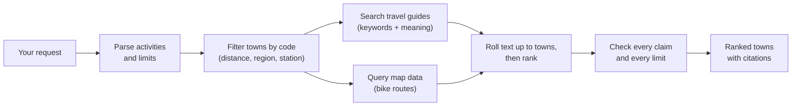

<div align="center">

# Waymark

**A trip finder that checks its answers.**

Say what you want to do. Waymark finds where to go, and shows why.

[](#roadmap)
[](LICENSE)
[](https://www.wikivoyage.org/)
[](https://www.openstreetmap.org/copyright)

</div>

> [!NOTE]
> **Early days.** Nothing below runs yet. The first step is the eval set and its scoring script, built before any
> app code, so every later change is measured against a fixed bar. This page describes the design.

## The idea

You don't type a place. You type what you want to do, and your limits:

> *Castles and bike paths, quiet, within 2 hours of Kraków, no car, 2 days.*

Waymark will answer with:

- **Towns that fit, ranked.** Each one with the guide sentences that show why.
- **A ✓ or ✗ for every hard limit:** distance, a train station for "no car", bike route length and surface.
  Computed by code from map data, not guessed by a model.
- **A day plan** for the town you pick, where every line links to its source.

A sketch of the planned output (placeholders, not real results):

```text
castles + bike paths · quiet · ≤ 2 h from Kraków · no car · 2 days

1. Town A   castle [1] · bike route 38 km, 80% asphalt (OSM) · station 0.6 km    ✓ distance  ✓ no car
2. Town B   castle [2] · no bike route found in OSM                               ✓ distance  ✓ no car

   A plain chatbot also suggested Town C:                                         ✗ too far from Kraków
```

## A plain chatbot guesses. Waymark checks.

A chatbot knows a lot about travel, and it sounds just as sure when it is wrong: a bike route that is longer than
it says, a station that isn't there, a town far outside your limit. Waymark doesn't try to know more. It checks more.

| | Plain chatbot | Waymark |
|---|---|---|
| **Sources** | none, or links that may not exist | every claim cites a Wikivoyage sentence |
| **Hard limits** | guessed | checked by code against OpenStreetMap |
| **Quality** | "looks good" | scored on a fixed eval set, with a held-out half |
| **Cost** | hidden | tokens and seconds shown for every answer |

## How it will work



- **Retrieval:** hybrid search (BM25 + embeddings, fused with reciprocal rank fusion), then an LLM reranker. Search
  returns text chunks; Waymark rolls them up into towns, because you asked *where*, not *which paragraph*.
- **Hard limits in code:** distance, region and station access are SQL filters and geometry, never a model's opinion.
- **Agent:** for day plans, a tool-using agent picks between guide text and map data, and must pass a checker
  before it answers.
- **Evals first:** ranking quality (nDCG@10, recall), lesser-known towns found, broken limits, citation
  faithfulness, cost and latency. Tuning and held-out scores are reported side by side.

## Roadmap

- [ ] **Eval set and harness.** Activity queries over Poland with a graded answer key and a held-out half, plus a
  script that scores any system. No app code yet.
- [ ] **Smoke test.** Run plain models through the same eval: is there a real gap to close? If not, rethink.
- [ ] **Repo setup.** Fast CI, protected `main`, pull requests only.
- [ ] **Data.** Wikivoyage dump and train stations into one SQLite file.
- [ ] **Find and Ask for Poland.** Ranked, cited towns, and cited answers to questions.
- [ ] **The decisive test.** Plain models vs Waymark on the held-out queries, with a go / no-go rule set in advance.
- [ ] **Bike routes** from OpenStreetMap: length, surface and nearest station, computed by code.
- [ ] **Plan agent and checker**, then evals for the plans.
- [ ] **Web page** with a map and citation pop-ups.
- [ ] **Scale** to every Wikivoyage guide, then **deploy** with a public eval page.

## Development

```bash
cp .env.example .env                  # your API keys go here; .env is never committed
git config core.hooksPath .githooks   # turns on the secret check before each commit
```

All changes go through pull requests. The plan for CI: pull request checks run on recorded model responses and need
no API keys; the paid eval runs only when a maintainer approves it.

## Data and licences

- **Code:** [MIT](LICENSE).
- **Travel guides:** [Wikivoyage](https://www.wikivoyage.org/), © Wikivoyage contributors,
  [CC BY-SA 4.0](https://creativecommons.org/licenses/by-sa/4.0/).
- **Map data:** [OpenStreetMap](https://www.openstreetmap.org/copyright), © OpenStreetMap contributors,
  [ODbL](https://opendatacommons.org/licenses/odbl/).

The Wikivoyage dump, the map extracts and the search index are not stored in this repo: scripts download and
rebuild them.
